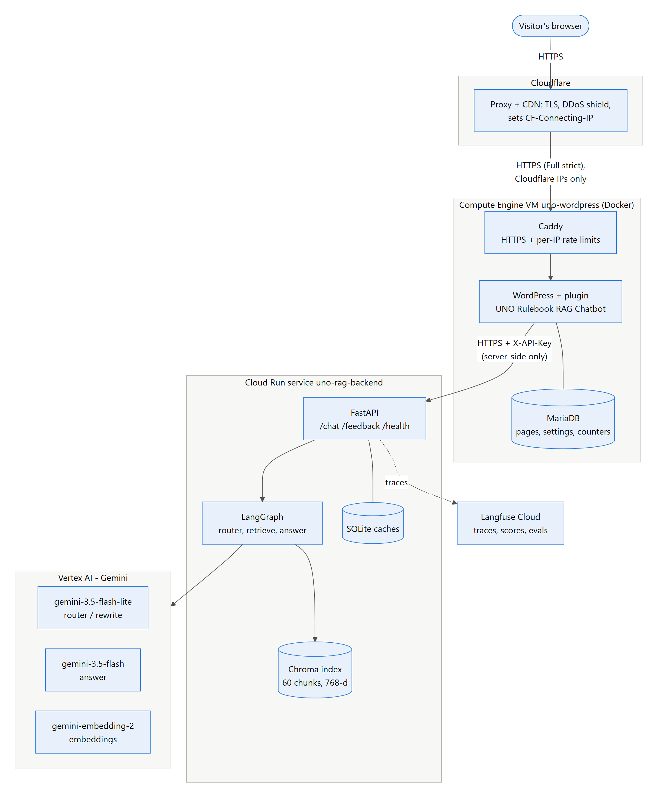
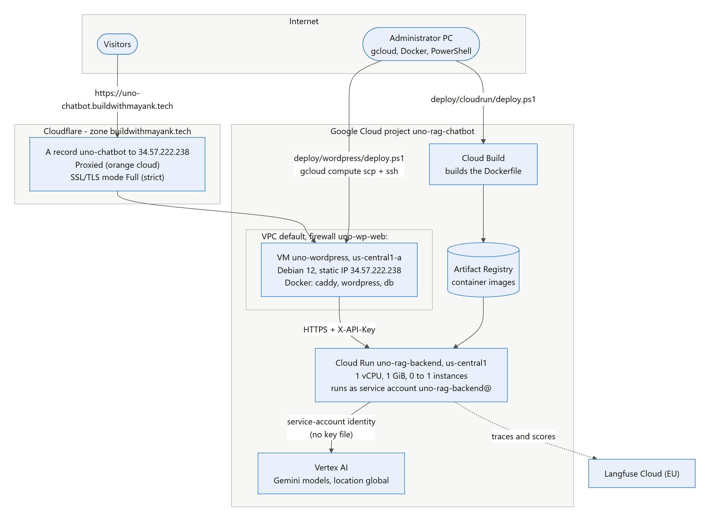
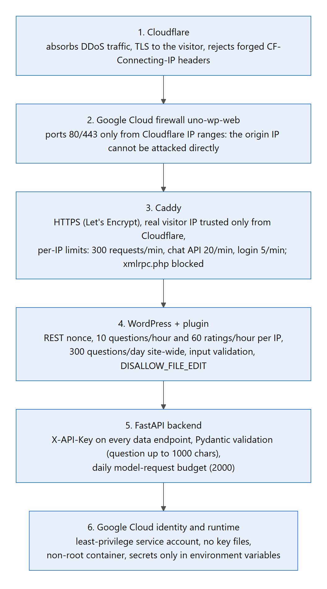

# UNO Rulebook RAG Chatbot

A retrieval-augmented chatbot that answers questions about five UNO rulebooks (Classic UNO, UNO Flip, UNO Dare, UNO No Mercy and UNO All Wild). Every answer comes only from the rulebook PDFs and shows the rulebook and page it came from.

| | |
|---|---|
| **Live site** | https://uno-chatbot.buildwithmayank.tech (chat: `/uno-rules-chat/`) |
| **Backend API** | Cloud Run service `uno-rag-backend` (`/health` is public; everything else needs `X-API-Key`) |
| **Full documentation** | [docs/UNO_RAG_Chatbot_Technical_Report.docx](docs/UNO_RAG_Chatbot_Technical_Report.docx) (also as PDF) |

**Stack:**
- **Backend:** Python 3.13, FastAPI, LangGraph, ChromaDB + BM25 hybrid search, pdfplumber
- **Models:** Google Gemini on Vertex AI (`gemini-3.5-flash-lite` routes, `gemini-3.5-flash` answers, `gemini-embedding-2` embeds)
- **Front end:** WordPress with a custom plugin, behind Caddy and Cloudflare
- **Monitoring:** Langfuse



**Request path:** the browser only ever talks to WordPress. The plugin forwards each question server-side to FastAPI with a secret API key. FastAPI runs the LangGraph flow:
1. a router model classifies the message
2. hybrid search picks 6 rulebook chunks
3. the answer model replies from those chunks only

## Contents
- [Project structure](#project-structure)
- [Local setup](#local-setup)
- [Cloud deployment](#cloud-deployment)
- [Configuration](#configuration)
- [API reference](#api-reference)
- [Security](#security)
- [Evaluation](#evaluation)
- [Monitoring](#monitoring)
- [Cost](#cost)
- [Troubleshooting](#troubleshooting)
- [Documentation tooling](#documentation-tooling)

## Project structure
```
app/                        FastAPI + LangGraph backend
  main.py                   API routes, API-key check, answer cache, Langfuse turn traces
  graph.py                  LangGraph state machine: analyze -> retrieve -> answer (-> rewrite_query)
  prompts.py                router, answer and rewrite prompts; fixed refusal texts
  llm.py                    Gemini clients, retries, daily request budget, SQLite caches, embeddings
  vectorstore.py            Chroma access, BM25 index, rulebook detection, hybrid search (RRF)
  ingest.py                 PDF -> cleaned text -> chunks -> embeddings -> Chroma
  observability.py          Langfuse client, callback handler, traces and scores
  formatting.py             strips Markdown from model output (plain-text answers)
  model_status.py           lists available Gemini models (python -m app.model_status)
  config.py                 all settings, loaded from .env
Data/                       the five rulebook PDFs
eval/                       dataset.py (labelled questions), run_eval.py, security_checks.py, results_*.json
wordpress/
  uno-rag-chatbot/          the WordPress plugin (PHP proxy + chat widget)
  setup/pages.php           creates the Home page, chat page and menu (local and cloud)
  setup.ps1                 local WordPress in Docker, fully configured
  build_zip.py              packages the plugin to dist/uno-rag-chatbot.zip
deploy/
  cloudrun/                 backend deploy: deploy.ps1, prepare_index.py, make_env.py
  wordpress/                VM deploy: deploy.ps1, vm-setup.sh, docker-compose.yml, Caddyfile, caddy/Dockerfile
docs/                       technical report (.docx/.pdf), diagrams/ (Mermaid sources + PNG), tools/, archive/
Dockerfile, .dockerignore, .gcloudignore   backend container image (Cloud Run builds it from the repo root)
docker-compose.yml          local WordPress + MariaDB (+ wp-cli) for development
requirements.txt, .env.example
```
Generated at runtime and git-ignored: `.venv/`, `.env`, `chroma_db/`, `cache/`, `dist/`, `deploy/build/`, `wordpress/admin-credentials*.txt`.

## Local setup
**Prerequisites:**
- Python 3.13
- Docker Desktop
- Google Cloud SDK
- a Google Cloud project with billing (trial credits work) and the Vertex AI API enabled

```powershell
python -m venv .venv
.venv\Scripts\activate
pip install -r requirements.txt
copy .env.example .env             # set GOOGLE_CLOUD_PROJECT and a long random BACKEND_API_KEY
gcloud auth application-default login
python -m app.model_status         # optional: checks the configured Gemini models (metadata only, free)
python -m app.ingest --reset       # embeds the PDFs into chroma_db/ (about 60 small requests)
python -m app.main                 # API on http://localhost:8000 (Swagger UI at /docs)
```

**Local WordPress:** start Docker Desktop, then run:
```powershell
powershell -ExecutionPolicy Bypass -File wordpress\setup.ps1
```
That gives you:
- **WordPress:** http://localhost:8080, with the admin login in `wordpress/admin-credentials.txt`
- **Plugin:** activated and pointed at `http://host.docker.internal:8000`, using the key from `.env`
- **Pages:** the Home page, the chat page `/uno-rules-chat/` and a Home-only menu

**Any other WordPress site:**
1. Build the plugin with `python wordpress/build_zip.py`.
2. Upload `dist/uno-rag-chatbot.zip` (Plugins → Add New → Upload).
3. Set the backend URL and key under **Settings → UNO Chatbot**.
4. Add `[uno_chatbot]` to a page.

## Cloud deployment


**1. Backend on Cloud Run** (`us-central1`, scale to zero, at most 1 instance):
```powershell
powershell -ExecutionPolicy Bypass -File deploy\cloudrun\deploy.ps1            # first time
powershell -ExecutionPolicy Bypass -File deploy\cloudrun\deploy.ps1 -SkipIamGrants   # updates
```
The script:
- enables the APIs
- creates the service account `uno-rag-backend@<project>` with **Vertex AI User**, so no key file is needed
- copies the local index into the image (`prepare_index.py`)
- turns `.env` into Cloud Run environment variables (`make_env.py`; the file is deleted afterwards)
- runs `gcloud run deploy --source .`

After changing the PDFs, run `python -m app.ingest --reset` and deploy again.

**2. WordPress on a Compute Engine VM** (e2-small, Docker: Caddy + WordPress + MariaDB):
```powershell
powershell -ExecutionPolicy Bypass -File deploy\wordpress\deploy.ps1                          # static IP, firewall, VM
# Cloudflare: A record  <domain> -> <printed IP>, Proxied (orange cloud); SSL/TLS mode "Full (strict)"
powershell -ExecutionPolicy Bypass -File deploy\wordpress\deploy.ps1 -Domain <domain>         # install / update
```
The second run:
1. waits until the domain is proxied by Cloudflare
2. uploads the plugin and setup files
3. runs `vm-setup.sh` on the VM, which installs Docker, builds Caddy with the rate-limit module, installs WordPress, configures the plugin and creates the pages
4. checks that the site answers through Cloudflare, then limits the firewall to Cloudflare's IP ranges

The admin login is saved to `wordpress/admin-credentials-gcp.txt`. Re-run the same command after changing the plugin; settings changed in wp-admin are kept. `-NoCloudflare` deploys without Cloudflare (DNS-only record, firewall open to everyone).

**Logs:**
- **Backend:** `gcloud run services logs read uno-rag-backend --region us-central1`
- **Site:** `gcloud compute ssh uno-wordpress --zone us-central1-a`, then `cd /opt/uno-wp && sudo docker compose logs -f`

## Configuration
All settings live in `.env` (see `.env.example`):

| Setting | Default | Purpose |
|---|---|---|
| `GOOGLE_CLOUD_PROJECT`, `GOOGLE_CLOUD_LOCATION` | –, `global` | Vertex AI project and location |
| `GOOGLE_APPLICATION_CREDENTIALS` | empty | optional service-account key file; empty = Application Default Credentials |
| `ROUTER_MODEL`, `ROUTER_THINKING` | `gemini-3.5-flash-lite`, `minimal` | routing, follow-up rewriting, small talk |
| `ANSWER_MODEL`, `ANSWER_THINKING` | `gemini-3.5-flash`, `low` | grounded answers |
| `LLM_TEMPERATURE`, `LLM_MAX_TOKENS` | `0.1`, `2000` | sampling and output limit (includes thinking tokens) |
| `EMBED_MODEL`, `EMBED_DIMENSIONS` | `gemini-embedding-2`, `768` | embeddings |
| `EMBED_QUERY_PREFIX`, `EMBED_DOC_PREFIX`, `EMBED_CONCURRENCY` | task prefixes, `8` | gemini-embedding-2 takes the task as a text prefix |
| `CHUNK_SIZE`, `CHUNK_OVERLAP`, `TOP_K` | `1000`, `150`, `6` | chunking and number of chunks per answer |
| `MAX_REWRITES`, `HISTORY_WINDOW`, `RETRIEVAL_MODE` | `1`, `6`, `hybrid` | retry with a rewritten query; chat history size; `bm25` skips the query embedding |
| `COLLECTION_NAME`, `DATA_DIR`, `CHROMA_DIR`, `CACHE_DIR` | `uno_docs_gemini`, `Data`, `chroma_db`, `cache` | storage |
| `DAILY_REQUEST_BUDGET`, `ANSWER_CACHE` | `2000`, `true` | model-request cap per UTC day; cache first-turn answers |
| `BACKEND_API_KEY` | – | shared secret WordPress sends as `X-API-Key` |
| `LANGFUSE_PUBLIC_KEY`, `LANGFUSE_SECRET_KEY`, `LANGFUSE_BASE_URL` | empty | monitoring (off when empty) |
| `LANGFUSE_ENVIRONMENT`, `LANGFUSE_FLUSH_EACH_REQUEST` | `local`, `false` | Cloud Run uses `production` and `true` |
| `API_HOST`, `API_PORT`, `AUTO_INGEST_ON_STARTUP`, `LOG_LEVEL` | `0.0.0.0`, `8000`, `true`, `INFO` | server |

Plugin settings (WordPress → Settings → UNO Chatbot):
- backend URL and API key
- title and welcome text
- floating bubble
- questions per visitor per hour (deployed: 10)
- questions per day for the whole site (300)

## API reference
**Backend (FastAPI):**

| Method | Path | Auth | Request → response |
|---|---|---|---|
| GET | `/` | – | → `{"service", "health", "docs"}` |
| GET | `/health` | – | → Gemini status, models, `requests_today`, `documents_in_collection`, Langfuse status |
| POST | `/chat` | `X-API-Key` | `{"question" (1–1000 chars), "session_id", "visitor"?}` → `{"answer", "sources": [{"source", "page"}], "cached", "trace_id"}` |
| POST | `/feedback` | `X-API-Key` | `{"trace_id" (32 hex), "value": 1 or -1, "comment"?}` → 204 |
| DELETE | `/chat/{session_id}` | `X-API-Key` | → `{"cleared": "<session_id>"}` (forgets the conversation) |
| POST | `/ingest` | `X-API-Key` | `{"reset": false}` → `{"files", "pages", "chunks", "collection_count"}` |

Errors:
- `401`: missing or wrong key
- `422`: invalid input
- `429`: daily budget reached
- `502`: model failure

**WordPress plugin (namespace `/wp-json/uno-chat/v1`, header `X-WP-Nonce`):**
- `POST /ask {question, session_id}` → `{answer, sources, cached, trace_id}`
- `POST /feedback {trace_id, value}`
- `POST /reset {session_id}`

Errors:
- `403`: bad nonce
- `429`: hourly or daily limit
- `502`: backend unreachable

## Security


- **Keys never reach the browser:**
  - `BACKEND_API_KEY` lives in `.env` (git-ignored), in Cloud Run environment variables, and in the WordPress options table.
  - WordPress adds it server-side, and the browser only gets a WordPress nonce.
  - Generated env files and upload bundles are deleted after each deploy.
- **No cloud key files:** Cloud Run calls Vertex AI as the service account `uno-rag-backend@` (Vertex AI User only), using short-lived tokens.
- **Network:**
  - Cloudflare proxies the site (DDoS protection).
  - The VM firewall only accepts Cloudflare's IP ranges, so the origin IP can't be reached directly.
  - TLS runs end to end: Cloudflare Full (strict) plus a Let's Encrypt certificate in Caddy.
- **Rate limits:**

  | Layer | Limit |
  |---|---|
  | Caddy, per visitor IP | 300 requests/min, chat API 20/min, login 5/min |
  | Plugin, per visitor IP | 10 questions/hour, 60 ratings/hour |
  | Plugin, whole site | 300 questions/day |
  | Backend | 2000 model requests/day |

  Over a limit, callers get `429` (Caddy's include `Retry-After`).
- **Spoofing:**
  - Caddy trusts the visitor IP (`CF-Connecting-IP`) only from Cloudflare's ranges, and passes it to WordPress as `X-Real-IP`, overwriting any client value.
  - Cloudflare itself rejects requests that try to set `CF-Connecting-IP`.
- **Hardening:**
  - non-root backend container
  - `DISALLOW_FILE_EDIT`
  - `xmlrpc.php` blocked
  - container logs capped
  - DB passwords generated on the VM (mode 600)
  - Pydantic and WordPress input validation
  - answers rendered with `textContent` (no HTML injection)
- **Automated check:** `python -m eval.security_checks` (26 checks, all passing on the live system).

## Evaluation
```powershell
python -m eval.run_eval                       # retrieval + end-to-end on the local graph -> eval/results_gemini.json
python -m eval.run_eval --retrieval-only      # retrieval metrics only
python -m eval.run_eval --backend-url https://<service>.run.app   # same questions against the deployed API -> eval/results_production.json
python -m eval.security_checks                # security checks against the live site and API -> eval/results_security.json
```

**Test set** (`eval/dataset.py`, labelled by hand):
- 31 rulebook questions with required facts and source PDFs
- 6 off-topic questions
- 16 small-talk messages
- 4 two-turn follow-up conversations

**Current results:**

| | Local graph | Deployed API (Cloud Run) |
|---|---|---|
| Rulebook answers correct | 31/31 (100%) | 31/31 (100%) |
| Correct rulebook cited | 100% | 100% |
| Off-topic refused | 6/6 | 6/6 |
| Small talk answered without retrieval | 16/16 | 16/16 |
| Follow-ups answered correctly | 4/4 | 4/4 |
| Median latency, rulebook question | 2.4 s | 2.5 s |

**Retrieval** (production hybrid search with the rulebook filter):
- correct rulebook ranked first for 96.8% of questions
- the answer chunk in the top 6 for 96.8%
- vector-only search reaches 100% recall@6, a candidate improvement

With Langfuse configured, rulebook questions also run as a Langfuse experiment on the dataset `uno-rulebook-qa`.

## Monitoring
Langfuse (optional) gets one trace per chat turn:
- **Steps:** the graph steps, every Gemini call (model, tokens, latency) and the retrieved chunks.
- **Grouping:** traces are grouped by session, with the visitor as an anonymous hash.
- **Tags:** `route:*`, `cached`, `refused`, `daily-limit` and `error`.
- **Feedback:** thumbs up/down in the widget is stored as the `user-feedback` score.

Set `LANGFUSE_PUBLIC_KEY`, `LANGFUSE_SECRET_KEY` and `LANGFUSE_BASE_URL` in `.env`. `/health` shows `"langfuse": {"enabled": true, "auth_ok": true}`. With the keys empty, monitoring is off and nothing else changes.

## Cost
**Gemini:** pay per use. Model requests per message:

| Message | Model requests |
|---|---|
| Small talk or off-topic | 1 |
| Rulebook question | 3 |
| Repeated first question | 0 (answer cache) |

A full eval run (about 100 requests) costs a few cents.

**Infrastructure:**
- **Cloud Run:** within the free tier at this traffic
- **VM e2-small:** about $13/month
- **Static IP:** about $3/month
- **20 GB disk:** about $2/month
- **Cloudflare and Langfuse Hobby:** free

Set a budget alert under Billing → Budgets & alerts. Stop the VM with `gcloud compute instances stop uno-wordpress --zone us-central1-a`; the static IP is still billed while it's stopped.

## Troubleshooting
| Symptom | Cause and fix |
|---|---|
| Chat says "session expired" (403) | Page cached with an old nonce: reload; exclude the chat page from full-page caches |
| "question limit for this hour" / "today's question limit" (429) | Plugin limits: raise them under Settings → UNO Chatbot |
| `429` with `Retry-After` on every page | Caddy per-IP limit: wait a minute |
| Cloudflare 521 / 522 | VM down or firewall wrong: re-run `deploy\wordpress\deploy.ps1 -Domain ...` |
| "Too many redirects" | Cloudflare SSL/TLS mode is Flexible: set **Full (strict)** |
| Settings page: "Backend not reachable" | Wrong backend URL, or Cloud Run cold start (first request after ~15 min idle takes a few seconds) |
| Backend `401` | `BACKEND_API_KEY` in the plugin differs from the backend: re-run the WordPress deploy |
| Backend `502` "AI service failed" | Gemini auth or quota: check `/health` and `gcloud auth application-default login` locally |

## Documentation tooling
The report and diagrams are generated from files in this repository:
```powershell
cd docs\tools; npm install; cd ..\..
python docs\tools\render_diagrams.py     # docs/diagrams/*.mmd -> PNG (needs: pip install playwright, Google Chrome)
python docs\tools\charts.py              # evaluation charts (needs: pip install matplotlib)
node docs\tools\build_report.js          # docs/UNO_RAG_Chatbot_Technical_Report.docx
powershell -ExecutionPolicy Bypass -File docs\tools\export_pdf.ps1   # fills the contents, exports the PDF (Microsoft Word)
```
The first report (Ollama era) and its evaluation results are kept in `docs/archive/`.
